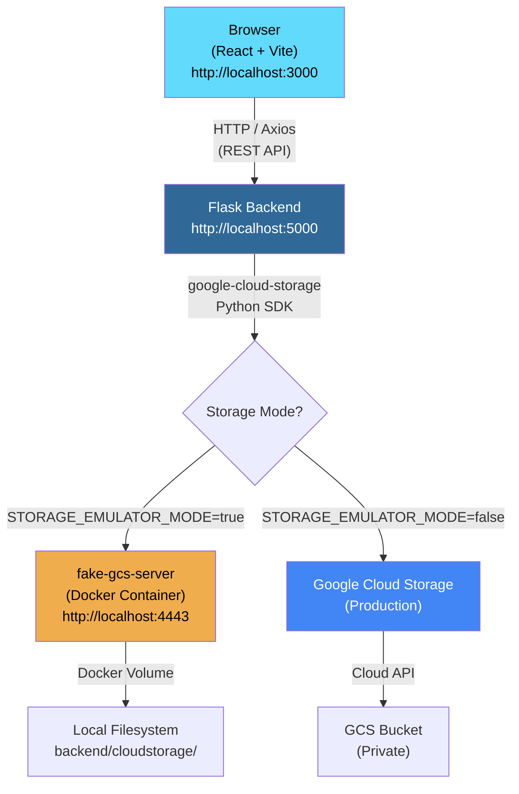
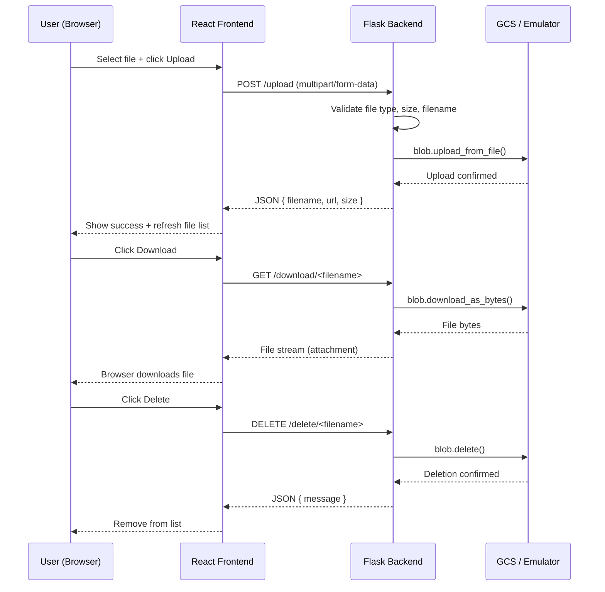

# CloudVault — Cloud-Based File Storage and Management System 🚀

> **Attribution:** This project is based on the original [Cloud File Uploader](https://github.com/kdrd004/cloud-file-uploader) repository by [@kdrd004](https://github.com/kdrd004). This version extends the original with full CRUD endpoints, local GCS emulator support, environment-variable-driven configuration, secure filenames, backend download proxy, file listing/deletion UI, and Cloud Run hardening.

> ⚠️ **Disclaimer:** Local emulator testing has been completed and confirms the application works end-to-end. However, production GCP deployment has **NOT** been verified. The emulator does not communicate with Google's production servers.

---

## 📌 Introduction

CloudVault is a full-stack web application that provides cloud-based file storage and management using **Google Cloud Storage**. Users can upload, list, download, and delete files through a clean web interface. The application supports both a local GCS-compatible emulator for development (requiring no billing) and production Google Cloud Storage.

## 🎯 Problem Statement

Cloud file storage solutions typically require active cloud provider billing and complex credential management during development. This creates barriers for developers who want to build and test cloud storage applications locally before committing to production infrastructure.

**CloudVault solves this by providing:**
- A dual-mode storage architecture (local emulator or production GCS).
- Zero-cost local development using Docker and `fake-gcs-server`.
- Seamless switching between local emulator and production Google Cloud Storage through environment variables.
- A complete file management workflow — upload, list, download, and delete — with a single configuration change to go from local testing to production deployment.

---

## ✨ Features

- **File Upload** — Drag-and-drop or select files up to 50 MB with extension validation.
- **File Listing** — Browse all stored files with name, size, upload date, and content type.
- **File Download** — Download files through backend proxy (emulator) or signed URLs (production).
- **File Deletion** — Remove individual files from storage with confirmation.
- **Health Monitoring** — Real-time backend connectivity and storage mode indicator.
- **Dual Storage Mode** — Switch between local emulator and production GCS via environment variable.
- **Secure Filenames** — UUID-prefixed, sanitised filenames prevent collisions and path traversal.
- **File Type Validation** — Server-side extension allowlist (images, documents, media, archives).
- **Persistent Storage** — Emulator data persists across application restarts via Docker volumes.
- **Cloud Run Ready** — Dockerfile configured with Gunicorn, configurable PORT, no baked-in credentials.

---

## 🛠️ Technology Stack

| Component | Technology | Purpose |
|-----------|-----------|---------|
| Frontend | React 18 + Vite 4 | Single-page file manager UI |
| UI Framework | Bootstrap 5 (CDN) | Responsive styling |
| HTTP Client | Axios | REST API requests |
| Backend | Python 3.11 + Flask 2.3 | REST API server |
| Storage SDK | google-cloud-storage 2.10 | Bucket and blob operations |
| GCS Emulator | fsouza/fake-gcs-server | Local development (no billing) |
| CORS | Flask-CORS 4.0 | Cross-origin resource sharing |
| WSGI Server | Gunicorn 21 | Production HTTP server |
| Containerisation | Docker | Application packaging |
| Deployment | Google Cloud Run | Serverless backend hosting |

---

## 🏗️ Architecture



### Request Flow



---

## 🔀 Storage Modes

| Feature | Emulator Mode | Production Mode |
|---------|---------------|-----------------|
| Environment variable | `STORAGE_EMULATOR_MODE=true` | `STORAGE_EMULATOR_MODE=false` |
| GCP billing | ❌ Not needed | ✅ Required |
| Credentials | Anonymous (none) | ADC or service account key |
| Storage backend | Docker volume (local) | Google Cloud Storage |
| Download mechanism | Backend proxy (`/download/<name>`) | v4 Signed URL (1-hour expiry) |
| Internet required | ❌ No | ✅ Yes |
| Docker required | ✅ Yes (fake-gcs-server) | ❌ No |

---

## 🖥️ Frontend

The React frontend provides a single-page application for file management:

- **Upload Card** — File picker with drag support, 50 MB limit display, upload progress spinner.
- **File List** — Table showing all stored files with name, size, upload date, and action buttons.
- **Health Badge** — Real-time indicator showing backend connectivity and storage mode (Emulator / GCS).
- **Download / Delete** — Per-file action buttons with confirmation dialogs.
- **Dynamic "How it Works"** — Adjusts explanation based on whether emulator or production mode is active.

The frontend communicates with the backend via Axios using `VITE_BACKEND_URL` from `frontend/.env`.

## 🐍 Backend

The Flask backend implements a RESTful API:

- **Environment-driven configuration** — All settings via `.env` (no hardcoded values).
- **Dual-mode storage client** — `AnonymousCredentials` + custom endpoint for emulator; ADC for production.
- **File validation** — Extension allowlist, 50 MB cap, `secure_filename` sanitisation.
- **UUID-prefixed naming** — Prevents filename collisions and enables original name recovery.
- **Download proxy** — Streams files from storage through Flask (required for emulator; optional for production).
- **Error handling** — Structured JSON errors with appropriate HTTP status codes.

## 📦 Google Cloud Storage Emulator

The application uses [`fsouza/fake-gcs-server`](https://github.com/fsouza/fake-gcs-server) as a local GCS-compatible emulator:

- Runs as a Docker container on port 4443.
- Provides a JSON API compatible with the official `google-cloud-storage` Python SDK.
- Data persists in `backend/cloudstorage/` via Docker volume mount.
- Supports bucket creation, object upload, listing, download, and deletion.
- Does **not** support production-style v4 signed URLs (handled by backend proxy instead).

---

## 🚀 Local Installation

### Prerequisites

| Tool | Version | Required For |
|------|---------|-------------|
| Python | 3.10+ | Backend |
| Node.js | 18+ | Frontend |
| Docker Desktop | Latest | GCS Emulator |

### 1. Clone the repository

```bash
git clone https://github.com/YOUR_USERNAME/cloud-file-uploader.git
cd cloud-file-uploader
```

### 2. Start the GCS emulator (Docker)

```bash
# Check if container already exists
docker ps -a --filter "name=cloudvault-gcs"

# First time — create and start
docker run -d --name cloudvault-gcs \
  -p 4443:4443 \
  -v "$(pwd)/backend/cloudstorage:/data" \
  fsouza/fake-gcs-server \
  -scheme http -port 4443 -public-host localhost:4443

# Windows (use absolute path):
docker run -d --name cloudvault-gcs ^
  -p 4443:4443 ^
  -v "C:/path/to/project/backend/cloudstorage:/data" ^
  fsouza/fake-gcs-server ^
  -scheme http -port 4443 -public-host localhost:4443

# If container already exists but is stopped:
docker start cloudvault-gcs

# Verify emulator responds:
curl http://localhost:4443/storage/v1/b
```

### 3. Create the emulator bucket

```bash
cd backend
python -c "
from google.cloud import storage
from google.auth.credentials import AnonymousCredentials
c = storage.Client(project='cloudvault-local', credentials=AnonymousCredentials(),
    client_options={'api_endpoint': 'http://localhost:4443'})
b = c.bucket('cloudvault-demo')
if not b.exists(): b.create()
print('Bucket ready:', b.exists())
"
```

### 4. Configure and run the backend

```bash
cd backend
cp .env.example .env
python -m venv venv

# Windows:
venv\Scripts\activate
# Linux/macOS:
# source venv/bin/activate

pip install -r requirements.txt
python app.py
```

### 5. Configure and run the frontend

```bash
cd frontend
cp .env.example .env
# Ensure frontend/.env contains: VITE_BACKEND_URL=http://localhost:5000
npm install
npm run dev
```

### 6. Access the application

| Service | URL |
|---------|-----|
| Frontend | http://localhost:3000 |
| Backend API | http://localhost:5000 |
| Health Check | http://localhost:5000/health |
| GCS Emulator | http://localhost:4443 |

---

## 🐳 Docker Configuration

### Emulator Container

The GCS emulator runs as a Docker container using `fsouza/fake-gcs-server`:

```bash
# Start (if stopped)
docker start cloudvault-gcs

# Stop (data persists in Docker volume)
docker stop cloudvault-gcs

# View logs
docker logs cloudvault-gcs

# Remove container (data remains in backend/cloudstorage/)
docker rm cloudvault-gcs
```

### Backend Dockerfile

The backend Dockerfile is configured for production deployment:
- Uses `python:3.11-slim` base image.
- Installs dependencies from `requirements.txt`.
- Copies only `app.py` — no credentials or `.env` files.
- Runs Gunicorn on configurable `PORT` (default 8080 for Cloud Run).
- Credentials provided at runtime via Cloud Run service account.

```bash
cd backend
docker build -t cloud-file-uploader-backend .
docker run -p 8080:8080 \
  -e GCS_BUCKET_NAME=your-bucket \
  -e STORAGE_EMULATOR_MODE=false \
  -e GOOGLE_APPLICATION_CREDENTIALS=/tmp/key.json \
  -v /path/to/key.json:/tmp/key.json:ro \
  cloud-file-uploader-backend
```

---

## 📡 API Endpoints

| Method | Path | Description |
|--------|------|-------------|
| `GET` | `/` | Root status check |
| `GET` | `/health` | Health check with mode info |
| `POST` | `/upload` | Upload file (multipart/form-data, `file` field) |
| `GET` | `/files` | List all files in bucket |
| `GET` | `/download/<filename>` | Download file through backend proxy |
| `DELETE` | `/delete/<filename>` | Delete file from bucket |

### Example: Health Response

```json
{
  "status": "healthy",
  "bucket_configured": true,
  "bucket": "cloudvault-demo",
  "emulator_mode": true,
  "emulator_host": "http://localhost:4443"
}
```

### Example: Upload Response

```json
{
  "url": "http://localhost:5000/download/a1b2c3d4..._myfile.pdf",
  "filename": "a1b2c3d4e5f6..._myfile.pdf",
  "original_name": "myfile.pdf",
  "size": 102400
}
```

### Example: Files Response

```json
{
  "files": [
    {
      "name": "a1b2c3d4e5f6..._myfile.pdf",
      "original_name": "myfile.pdf",
      "url": "http://localhost:5000/download/a1b2c3d4..._myfile.pdf",
      "size": 102400,
      "created": "2025-01-01T12:00:00+00:00",
      "content_type": "application/pdf"
    }
  ]
}
```

---

## 📤 Upload, Listing, Download and Deletion Workflow

1. **Upload** — User selects a file in the frontend. The file is sent via `POST /upload` as `multipart/form-data`. The backend validates the file type and size, generates a UUID-prefixed secure filename, uploads it to the storage bucket, and returns the file metadata including a download URL.

2. **Listing** — The frontend calls `GET /files` on mount and after uploads/deletions. The backend lists all blobs in the bucket and returns each file's name, original name, size, creation date, content type, and download URL.

3. **Download** — User clicks the download button. The frontend opens `GET /download/<filename>`. The backend fetches the blob bytes from storage and streams them to the browser as an attachment with the original filename.

4. **Deletion** — User clicks delete and confirms. The frontend sends `DELETE /delete/<filename>`. The backend removes the blob from the bucket and the frontend removes the file from the displayed list.

---

## 📦 Supported File Types and Limits

| Category | Extensions |
|----------|-----------|
| Images | `.png`, `.jpg`, `.jpeg`, `.gif`, `.webp` |
| Documents | `.pdf`, `.txt`, `.doc`, `.docx`, `.csv`, `.xlsx`, `.xls` |
| Media | `.mp4`, `.mp3` |
| Archives | `.zip` |
| **Maximum size** | **50 MB** |

---

## 🔒 Security Considerations

- `.env` files and credential JSON keys are excluded via `.gitignore`.
- No broad `*.json` exclusion — `package.json` and other required JSON files remain tracked.
- Files stored with UUID-prefixed unique names to prevent collisions.
- `werkzeug.utils.secure_filename` sanitises all uploaded filenames.
- File extensions validated against a server-side allowlist.
- Upload size capped at 50 MB (`MAX_CONTENT_LENGTH`).
- Emulator mode uses `AnonymousCredentials` — never connects to real GCP.
- Production mode uses Application Default Credentials or explicit service account keys.
- Download endpoint prevents path traversal attacks.
- CORS restricted to configured origins only.
- Docker image contains no credentials — runtime service account used on Cloud Run.

---

## ☁️ Production Google Cloud Storage Configuration

To switch from local emulator to production GCS, edit `backend/.env`:

```bash
GCS_BUCKET_NAME=your-real-bucket-name
GOOGLE_CLOUD_PROJECT=your-gcp-project-id
STORAGE_EMULATOR_HOST=
STORAGE_EMULATOR_MODE=false
GOOGLE_APPLICATION_CREDENTIALS=/absolute/path/to/service-account-key.json
```

Or use Application Default Credentials:
```bash
gcloud auth application-default login
```

### Required IAM Roles

| Role | Reason |
|------|--------|
| `roles/storage.objectAdmin` | Upload, list, download, delete objects |
| `roles/iam.serviceAccountTokenCreator` | Generate v4 signed download URLs |

### GCS Bucket Setup

```bash
gcloud config set project YOUR_PROJECT_ID
gsutil mb -p YOUR_PROJECT_ID -l us-central1 gs://YOUR_BUCKET_NAME
```

---

## ☁️ Cloud Run Deployment

```bash
cd backend

# Build and submit
gcloud builds submit --tag gcr.io/YOUR_PROJECT_ID/cloud-file-uploader

# Deploy
gcloud run deploy cloud-file-uploader \
  --image gcr.io/YOUR_PROJECT_ID/cloud-file-uploader \
  --platform managed \
  --region us-central1 \
  --allow-unauthenticated \
  --service-account=file-uploader-sa@YOUR_PROJECT_ID.iam.gserviceaccount.com \
  --set-env-vars GCS_BUCKET_NAME=YOUR_BUCKET_NAME \
  --set-env-vars STORAGE_EMULATOR_MODE=false \
  --set-env-vars CORS_ORIGIN=https://your-frontend-domain.com
```

After deploying, update `frontend/.env`:
```
VITE_BACKEND_URL=https://YOUR_CLOUD_RUN_URL
```

---

## ⚠️ Limitations and Future Enhancements

### Current Limitations

- Local emulator testing does **not** validate production GCP deployment.
- `fake-gcs-server` does not support all GCS features (IAM conditions, lifecycle policies, notifications).
- v4 signed URLs are not supported by the emulator; backend proxy is used instead.
- Emulator performance characteristics differ from production GCS.
- No user authentication or access control implemented.
- No upload progress percentage display.
- Single-bucket architecture only.

### Potential Future Enhancements

- User authentication with Google OAuth 2.0 or Firebase Auth.
- Upload progress bar with real-time percentage.
- File preview (images, PDFs) before download.
- Folder organisation within the bucket.
- File sharing with expiring links.
- Drag-and-drop upload area.
- Multiple file upload.
- File versioning.
- CI/CD pipeline with Cloud Build.

---

## 🐛 Troubleshooting

### Emulator not responding

```bash
docker ps                                     # Verify container is running
docker logs cloudvault-gcs                     # Check for errors
curl http://localhost:4443/storage/v1/b        # Test API directly
```

### "bucket_configured: false" in health check

Ensure `GCS_BUCKET_NAME` is set in `backend/.env`.

### CORS errors in browser console

- Confirm Flask is running on port 5000.
- Confirm `VITE_BACKEND_URL=http://localhost:5000` in `frontend/.env`.
- Confirm `ALLOWED_ORIGINS` includes `http://localhost:3000`.

### Download returns "Not Found"

Use the `name` field from the `/files` response (the UUID-prefixed name), not `original_name`.

---

## 📝 License

MIT — see original repository for full licence text.

## 👨‍💻 Attribution

Original project: [github.com/kdrd004/cloud-file-uploader](https://github.com/kdrd004/cloud-file-uploader) by [@kdrd004](https://github.com/kdrd004).
Extended with local emulator support, full CRUD API, download proxy, file management UI, and Cloud Run deployment configuration.
